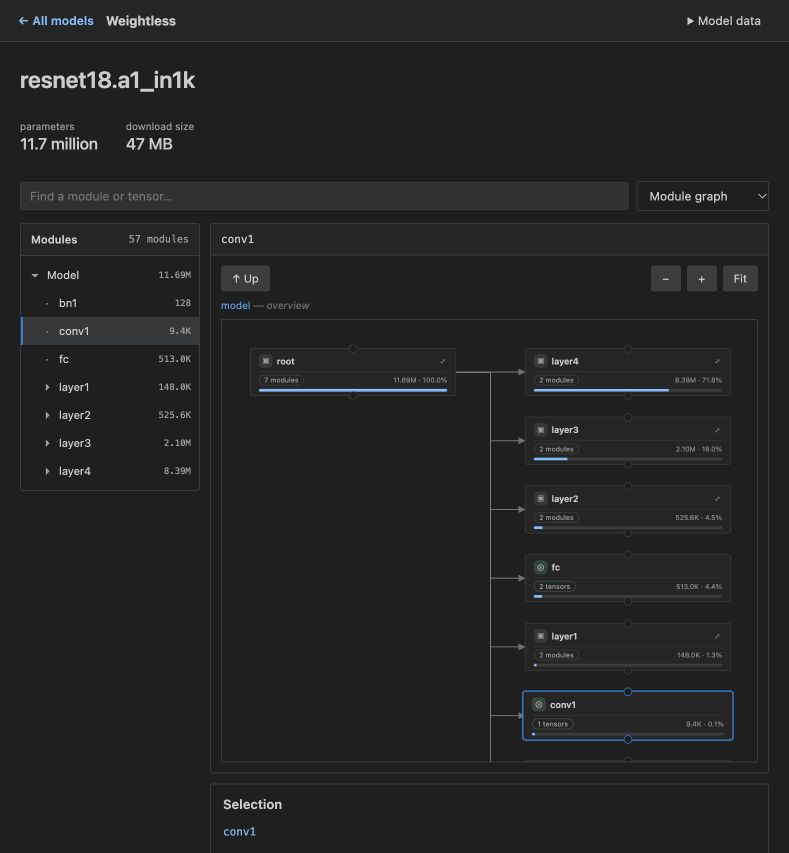

# Weightless

**Inspect open-weight models in VS Code.**

Open a `.safetensors` or `.gguf` file, browse the model gallery, or load a Hugging Face model by ID. Weightless reads tensor headers and available configuration without downloading the full weights.

[VS Code Marketplace](https://marketplace.visualstudio.com/items?itemName=kipngenokoech.weightless) · [Open VSX](https://open-vsx.org/extension/kipngenokoech/weightless) · [Browser viewer](https://kkipngenokoech.github.io/weightless/) · [Hugging Face Space](https://huggingface.co/spaces/kkipngenokoech/weightless)



## Inspect a model

- **Architecture workspace**. Search the module tree, select a module in the graph, drill into its children, and inspect tensor shapes, parameter counts, storage and dtypes. Selection stays synchronized across views.
- **Paper diagrams**. Recognized transformer stacks offer a schematic with attention, feed-forward, normalization and residual stages. Other architectures retain the module graph and tensor inventory.
- **Input, hidden layers and output**. Recognized model families show their stages, dimensions and parameter distribution. Parameter and memory controls update interactively.
- **Tensors and model data**. Expand the scoped, searchable tensor table when needed. Open **Model data** for loaded configuration, metadata and available training, generation, adapter or tokenizer sidecars.
- **Training exploration**. Plan trainable and frozen parameter groups and explore a one-weight learning example with an adjustable learning rate.

The interface follows the active VS Code theme. Tensor details and configuration stay collapsed until opened.

## Formats and sources

Single-file and sharded `.safetensors` checkpoints are supported, including adjacent `model.safetensors.index.json` files. `.gguf` support includes quantized dtypes, tensor storage sizes and architecture metadata.

Run **Weightless: Browse Open Models** for the gallery or **Weightless: Open Model from Hugging Face Hub** to enter a repository ID. Hub loading uses HTTP range requests and supports `HF_TOKEN` for gated repositories.

The module tree and graph describe checkpoint structure. Paper diagrams use recognized architecture conventions. Recorded execution, live activations and actual per-parameter training flags require information beyond a weight header. Trainable/frozen controls represent the selected training plan.

## Develop

```bash
git clone https://github.com/kkipngenokoech/weightless.git
cd weightless
npm test
```

Press F5 in VS Code to launch an Extension Development Host. Open a model file or run **Weightless: Browse Open Models**.

Run the DOM interaction checks with a temporary test dependency.

```bash
npm install --prefix /tmp/weightless-test --no-save --ignore-scripts jsdom@26.1.0
NODE_PATH=/tmp/weightless-test/node_modules node test/explain.js
NODE_PATH=/tmp/weightless-test/node_modules node test/workspace.js
```

Package the extension with `npx @vscode/vsce package`.

## License

MIT. See [LICENSE](LICENSE).
